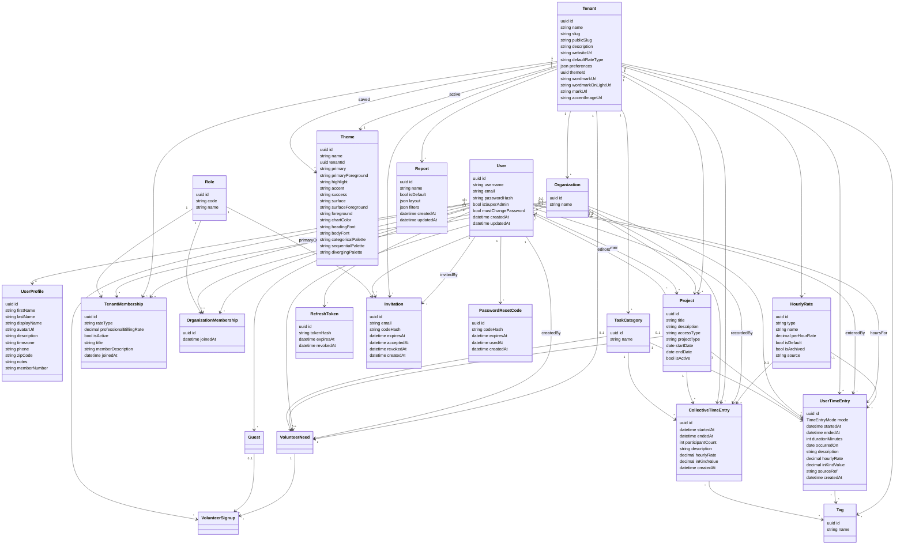

# VolunTime domain schema

This document describes the VolunTime domain. Next.js is the only backend and uses Prisma with PostgreSQL. Prisma owns migrations in `prisma/migrations`; `prisma/schema.prisma` defines modeled objects and migration SQL preserves additional database constraints and reference data. This document does not define HTTP routes.

Next.js server actions and REST routes use the same feature services. Users and refresh tokens live in PostgreSQL. Existing databases adopt Prisma without recreating tables; see the [adoption runbook](../ops/prisma-adoption.md).

Identifiers are UUIDs. Instants are `timestamptz`. `username` and `email` are stored lowercase and are unique. Money rates use `decimal(10,2)`. In-kind totals use `decimal(12,2)`.

CASWJ workbook mapping: the umbrella org is one `Tenant`; spreadsheet Groups are `Organization`; free-form log Tags stay org-scoped `Tag`. Entry notes are the `description` field.

## Model

`TimeEntryMode` is `Punch`, `Duration`, or `Total`. Seed `Role.code` with `MEMBER`, `VOLUNTEER`, and `ADMIN`. The same role rows are used on tenant and organization memberships. `HourlyRate.type`, `defaultRateType`, and membership `rateType` are `Volunteer`, `Professional`, or `Paid` (stored as text). `Paid` is compensation: the entry snapshots the pay rate and stores `inKindValue` as zero. Gross pay is hours times that snapshot and is reported only on the payroll view. `accessType` is `Public`, `Private`, or `Organization` (stored as text). `headingFont` and `bodyFont` are `HelveticaNeue`, `AvenirNext`, `SourceSans3`, `NunitoSans`, or `Geist`. Helvetica Neue and Avenir Next are system font names with Source Sans 3 and Nunito Sans fallbacks. Tag and project-editor links are many-to-many; join tables are not domain entities. Color fields are `#RRGGBB`.

## Entities

Foreign keys below are the relationship ends from the diagram. Tag and project-editor links are a many-to-many. Prisma and EF may use an implicit join; those join tables are not domain entities.

### User

| Field              | Required | Notes                                                                                                                                          |
| ------------------ | -------- | ---------------------------------------------------------------------------------------------------------------------------------------------- |
| id                 | yes      | UUID primary key                                                                                                                               |
| username           | yes      | Unique, stored lowercase. Login identifier                                                                                                     |
| email              | yes      | Unique, stored lowercase                                                                                                                       |
| passwordHash       | yes      | Hash only. Never store the password                                                                                                            |
| isSuperAdmin       | yes      | Default false. User-level flag, not a membership role. Bypasses membership checks                                                              |
| mustChangePassword | yes      | Default false. Set when an admin creates the account with a temporary password. Cleared when the user sets a new password or completes a reset |
| createdAt          | yes      |                                                                                                                                                |
| updatedAt          | yes      |                                                                                                                                                |

### UserProfile

One profile per user. `timezone` is an IANA name and defaults to `UTC`. `displayName`, `avatarUrl`, `description`, `phone`, `zipCode`, and `notes` are optional. `description` is Markdown. `firstName` and `lastName` are required. Rate type and professional rate live on `TenantMembership`, not on the profile. `memberNumber` is an optional Volunteer ID (`001`…).

| Field        | Required | Notes                                       |
| ------------ | -------- | ------------------------------------------- |
| id           | yes      | UUID primary key                            |
| userId       | yes      | Unique foreign key to User                  |
| firstName    | yes      |                                             |
| lastName     | yes      |                                             |
| displayName  | no       |                                             |
| avatarUrl    | no       |                                             |
| description  | no       | Markdown                                    |
| timezone     | yes      | IANA name, default `UTC`                    |
| phone        | no       |                                             |
| zipCode      | no       | Workbook Zip Code                           |
| notes        | no       |                                             |
| memberNumber | no       | Volunteer ID shown on the Volunteer Log CSV |

### Role

Lookup shared by tenant and organization memberships. Seed three system rows: `VOLUNTEER` (Volunteer), `MEMBER` (Staff), and `ADMIN` (Admin). Group manager is not a role row — it is `OrganizationMembership` with `ADMIN`.

| Field | Required | Notes                                     |
| ----- | -------- | ----------------------------------------- |
| id    | yes      | UUID primary key                          |
| code  | yes      | Unique. `VOLUNTEER`, `MEMBER`, or `ADMIN` |
| name  | yes      | Display name: Volunteer, Staff, or Admin  |

### Tenant

In-kind valuation catalogs live on `HourlyRate`. Creating an tenant seeds `defaultRateType` `Volunteer` and one default volunteer `HourlyRate` named `Volunteer` at `35.47`. The HTTP tenant still exposes `volunteerHourlyRate` as that default rate.

| Field              | Required | Notes                                                                                                                                                                                                                                                                                                                                                                                                                                                                |
| ------------------ | -------- | -------------------------------------------------------------------------------------------------------------------------------------------------------------------------------------------------------------------------------------------------------------------------------------------------------------------------------------------------------------------------------------------------------------------------------------------------------------------- |
| id                 | yes      | UUID primary key                                                                                                                                                                                                                                                                                                                                                                                                                                                     |
| name               | yes      |                                                                                                                                                                                                                                                                                                                                                                                                                                                                      |
| slug               | no       | Unique case-insensitive (`citext`) subdomain label for `{slug}.{APP_HOST}` white-label hosting (1–63 lowercase letters, digits, or hyphens, not starting or ending with a hyphen, and not in the reserved host list). Null when not launched.                                                                                                                                                                                                                        |
| publicSlug         | no       | Unique case-insensitive slug for `/openings/{publicSlug}`.                                                                                                                                                                                                                                                                                                                                                                                                           |
| description        | no       | Tenant about information in Markdown                                                                                                                                                                                                                                                                                                                                                                                                                           |
| websiteUrl         | no       |                                                                                                                                                                                                                                                                                                                                                                                                                                                                      |
| defaultRateType    | yes      | `Volunteer`, `Professional`, or `Paid`, default `Volunteer`                                                                                                                                                                                                                                                                                                                                                                                                          |
| preferences        | yes      | jsonb. `allowTimeEntryEditing` defaults to false. When false, a time entry update cannot change `startedAt`, `endedAt`, `durationMinutes`, or `occurredOn`. `allowVolunteersToAddVolunteers` defaults to false. When true, a volunteer can create another volunteer and must record a relationship. `entityLabels` holds display names for `tenant`, `project`, `organization`, and `taskCategory` (defaults: Tenant, Project, Organization, Task category). |
| themeId            | yes      | Foreign key to Theme. Defaults to the seeded VolunTime global theme.                                                                                                                                                                                                                                                                                                                                                                                                 |
| wordmarkUrl        | no       | Light-on-dark sidebar wordmark. Stays on the tenant so switching themes does not wipe marks. Uploads are resized to fit 800×200, stored privately, and served at `/brand/wordmark` for members.                                                                                                                                                                                                                                                                |
| wordmarkOnLightUrl | no       | Dark-on-light wordmark for light surfaces. Same resize and private storage as `wordmarkUrl`, served at `/brand/wordmarkOnLight`.                                                                                                                                                                                                                                                                                                                                     |
| markUrl            | no       | Compact mark for favicon-sized use. Uploads are cropped to 64×64, stored privately, and served at `/brand/mark` for members.                                                                                                                                                                                                                                                                                                                                         |
| accentImageUrl     | no       | Decorative image for login, enrollment, empty states, and header bands, never behind tables or forms                                                                                                                                                                                                                                                                                                                                                                 |

### Theme

Global presets have `tenantId` empty and are read-only. Tenants can save named copies. Palettes are JSON arrays of `#RRGGBB` colors: categorical 6–8, sequential 5–10, diverging 7. Seed seven global themes: VolunTime, Harbor, Atelier, Evergreen, Orchid, Okabe–Ito, and Tol Bright.

| Field              | Required | Notes                                                 |
| ------------------ | -------- | ----------------------------------------------------- |
| id                 | yes      | UUID primary key                                      |
| name               | yes      |                                                       |
| tenantId     | no       | Empty for a global preset. Set for an org-saved theme |
| primary            | yes      | `#RRGGBB`. Sidebar, headings, primary buttons         |
| primaryForeground  | yes      | `#RRGGBB`. Text on primary                            |
| highlight          | yes      | `#RRGGBB`. Emphasis and active nav, not body text     |
| accent             | yes      | `#RRGGBB`. Small accents                              |
| success            | yes      | `#RRGGBB`. Success states                             |
| surface            | yes      | `#RRGGBB`. Canvas and cards                           |
| surfaceForeground  | yes      | `#RRGGBB`. Text on surface                            |
| foreground         | yes      | `#RRGGBB`. Body text                                  |
| chartColor         | yes      | `#RRGGBB`. Base color for every chart                 |
| headingFont        | yes      | `HelveticaNeue`, `AvenirNext`, `SourceSans3`, `NunitoSans`, or `Geist` |
| bodyFont           | yes      | `HelveticaNeue`, `AvenirNext`, `SourceSans3`, `NunitoSans`, or `Geist` |
| categoricalPalette | yes      | JSON array of 6–8 `#RRGGBB` colors                    |
| sequentialPalette  | yes      | JSON array of 5–10 `#RRGGBB` colors                   |
| divergingPalette   | yes      | JSON array of 7 `#RRGGBB` colors                      |

### HourlyRate

An tenant-scoped catalog of rates. Names are unique within that tenant, compared case-insensitively. Exactly one volunteer rate per tenant has `isDefault` true.

| Field          | Required | Notes                                                                                                                                        |
| -------------- | -------- | -------------------------------------------------------------------------------------------------------------------------------------------- |
| id             | yes      | UUID primary key                                                                                                                             |
| tenantId | yes      | Foreign key to Tenant                                                                                                                  |
| type           | yes      | `Volunteer`, `Professional`, or `Paid`. Only a volunteer rate can be the default. Paid hours are gross pay, not in-kind. |
| name           | yes      | Unique per tenant, case-insensitive                                                                                                    |
| perHourRate    | yes      | decimal(10,2), greater than zero                                                                                                             |
| isDefault      | yes      | Default false. True only when `type` is `Volunteer`. One default volunteer rate per tenant                                             |
| isArchived     | yes      | Default false. Archived rates stay on the tenant and cannot be selected for new entries. The default volunteer rate cannot be archived |
| source         | no       | Where the amount comes from, 1 to 200 characters. Empty when omitted                                                                         |

### TenantMembership

A user has at most one membership in a given tenant. A person may belong to more than one organization through `OrganizationMembership`. `primaryOrganizationId`, when set, is a organization of this tenant and is only the default on the log form. Membership `rateType` and `professionalBillingRate` are kept on the membership and do not set time-entry rates.

| Field                   | Required | Notes                                                                                     |
| ----------------------- | -------- | ----------------------------------------------------------------------------------------- |
| id                      | yes      | UUID primary key                                                                          |
| userId                  | yes      | Foreign key to User. Unique with tenantId                                           |
| tenantId          | yes      | Foreign key to Tenant. Unique with userId                                           |
| roleId                  | yes      | Foreign key to Role                                                                       |
| rateType                | yes      | `Volunteer`, `Professional`, or `Paid`. Default from the org’s `defaultRateType` at join time. `Professional` and `Paid` require `professionalBillingRate` greater than zero. |
| professionalBillingRate | no       | decimal(10,2). Required and greater than zero when `Professional`; empty when `Volunteer` |
| isActive                | yes      | Default true. Workbook Active? without deleting history                                   |
| primaryOrganizationId     | no       | Foreign key to Organization. Cleared when that organization is deleted                        |
| title            | no       | Title of the user for this tenant                                                   |
| memberDescription      | no       | Description of the user for this tenant in Markdown                                 |
| joinedAt                | yes      |                                                                                           |

### MemberConnection

One relationship between two members of an tenant. `userAId` is the lower user id as text. `relationship` is how user B relates to user A. Callers send the label from one person's point of view (`Child` means the other person is their child) and the API stores the inverse when it swaps the pair. A pair can be connected once. Turning off `allowVolunteersToAddVolunteers` does not remove connections.

| Field           | Required | Notes                                                                                                                               |
| --------------- | -------- | ----------------------------------------------------------------------------------------------------------------------------------- |
| id              | yes      | UUID primary key                                                                                                                    |
| tenantId  | yes      | Foreign key to Tenant                                                                                                         |
| userAId         | yes      | Foreign key to User. Lower than `userBId`                                                                                           |
| userBId         | yes      | Foreign key to User                                                                                                                 |
| relationship    | yes      | `Parent`, `Child`, `Spouse`, `Sibling`, `Grandparent`, `Grandchild`, `Guardian`, `Dependent`, `Friend`, `Colleague`, or `Associate` |
| createdByUserId | yes      | Foreign key to User. The person who recorded the connection                                                                         |
| createdAt       | yes      |                                                                                                                                     |

### Report

A named report design for one tenant. `layout` is the card grid. `filters` is the saved report query (`organizationId`, `taskCategoryId`, `projectId`, `userId`, `from`, `to`). Names are unique within the tenant, compared case-insensitively. At most one report per tenant has `isDefault` true.

| Field          | Required | Notes                                                                   |
| -------------- | -------- | ----------------------------------------------------------------------- |
| id             | yes      | UUID primary key                                                        |
| tenantId | yes      | Foreign key to Tenant. Cascade delete                             |
| name           | yes      | Unique per tenant, case-insensitive. 1–80 characters              |
| isDefault      | yes      | Default false. Partial unique index allows one default per tenant |
| layout         | yes      | jsonb. Versioned card grid                                              |
| filters        | yes      | jsonb. Saved report query. Empty object means no extra filter           |
| createdAt      | yes      |                                                                         |
| updatedAt      | yes      |                                                                         |

### ReportTemplate

A reusable card layout. `tenantId` null is a global template. A row with `baseTemplateId` is one tenant's override of that global and is shown instead of the global for that tenant. Org-owned templates have an tenant and no base. Templates store a layout only, not filters. Names are unique among globals, and unique within an tenant, compared case-insensitively.

| Field          | Required | Notes                                                                                     |
| -------------- | -------- | ----------------------------------------------------------------------------------------- |
| id             | yes      | UUID primary key                                                                          |
| tenantId | no       | Null for a global template. Foreign key to Tenant. Cascade delete                   |
| key            | no       | `summary`, `people`, `groups`, or `staff` on a global. Null on tenant rows          |
| name           | yes      | 1–80 characters                                                                           |
| layout         | yes      | jsonb. Versioned card grid                                                                |
| baseTemplateId | no       | Null, or the global template this row overrides. One override per tenant per global |
| createdAt      | yes      |                                                                                           |
| updatedAt      | yes      |                                                                                           |

### EmailTemplate

One tenant's copy of a transactional email. Every tenant gets one row per `for` when it is created; the `EmailTemplates` migration backfilled existing tenants. Defaults come from [emails/defaults.ts](../../emails/defaults.ts), built into `emails/dist/defaults.json` by `npm run email:render`. Mail falls back to that default when an tenant has no row (and always for a password reset when the person belongs to zero or several tenants, or feedback with no tenant).

| Field          | Required | Notes                                                                                                                                                                                                                                                     |
| -------------- | -------- | --------------------------------------------------------------------------------------------------------------------------------------------------------------------------------------------------------------------------------------------------------- |
| id             | yes      | UUID primary key                                                                                                                                                                                                                                          |
| tenantId | yes      | Foreign key to Tenant. Cascade delete. Unique with `for`                                                                                                                                                                                            |
| name           | yes      | 1–80 characters. Admin label                                                                                                                                                                                                                              |
| version        | yes      | Starts at 1. Each patch or reset adds 1                                                                                                                                                                                                                   |
| for            | yes      | `Invite`, `Welcome`, `PasswordReset`, `LoggedTime`, `UnclassifiedEntry`, `FeedbackReceived`, `FeedbackNotify`, `FeedbackCompleted`, `AccessRequestReceived`, `AccessRequestDecided`, `NeedSubmitted`, `NeedDecided`, `VolunteerMessage`. Fixed after seed |
| subject        | yes      | 1–200 characters. May use `{{field.name}}`                                                                                                                                                                                                                |
| heading        | yes      | Title in the navy header                                                                                                                                                                                                                                  |
| preview        | yes      | Inbox preview text. May be empty                                                                                                                                                                                                                          |
| template       | yes      | Sanitized HTML body (`p`, `h1`–`h3`, `strong`, `em`, `a`, `ul`, `ol`, `li`, `br`, `span`)                                                                                                                                                                 |
| isEnabled      | yes      | Only `LoggedTime` and `UnclassifiedEntry` can be turned off; a disabled one sends nothing                                                                                                                                                                 |
| createdAt      | yes      |                                                                                                                                                                                                                                                           |
| updatedAt      | yes      |                                                                                                                                                                                                                                                           |

Placeholders are `{{path.to.field}}`. Each `for` has a fixed field catalog in [src/lib/email/templates.ts](../../src/lib/email/templates.ts). Saving rejects a field outside that catalog. Sending fails if the template uses a field the sender did not provide. Values are HTML-encoded in the body, and line breaks become ` `. A paragraph that holds only a `*.code` field renders as the gold code box.

### Organization

A organization belongs to exactly one tenant. Names are unique within that tenant, compared case-insensitively.

| Field          | Required | Notes                                     |
| -------------- | -------- | ----------------------------------------- |
| id             | yes      | UUID primary key                          |
| tenantId | yes      | Foreign key to Tenant               |
| name           | yes      | Unique per tenant, case-insensitive |

### OrganizationMembership

A user has at most one membership in a given organization and may belong to many organizations in the same tenant. The user must already belong to that organization’s tenant.

| Field        | Required | Notes                                         |
| ------------ | -------- | --------------------------------------------- |
| id           | yes      | UUID primary key                              |
| userId       | yes      | Foreign key to User. Unique with organizationId |
| organizationId | yes      | Foreign key to Organization. Unique with userId |
| roleId       | yes      | Foreign key to Role                           |
| joinedAt     | yes      |                                               |

### Tag

A tag belongs to one tenant. Names are unique within that tenant, compared case-insensitively.

| Field          | Required | Notes                                     |
| -------------- | -------- | ----------------------------------------- |
| id             | yes      | UUID primary key                          |
| tenantId | yes      | Foreign key to Tenant               |
| name           | yes      | Unique per tenant, case-insensitive |

### TaskCategory

An org-scoped lookup, same uniqueness pattern as Tag. Each tenant creates its own categories (for example Board Hours, Committee Member Hours, Participant Hours, Volunteer Hours). Not globally seeded.

| Field          | Required | Notes                                     |
| -------------- | -------- | ----------------------------------------- |
| id             | yes      | UUID primary key                          |
| tenantId | yes      | Foreign key to Tenant               |
| name           | yes      | Unique per tenant, case-insensitive |

### Project

A project belongs to an tenant. When `accessType` is `Organization`, it also belongs to one of that tenant’s organizations. Workbook “General / No Specific Project” is a normal project row the tenant creates; the schema does not auto-seed it.

| Field          | Required | Notes                                                                                       |
| -------------- | -------- | ------------------------------------------------------------------------------------------- |
| id             | yes      | UUID primary key                                                                            |
| tenantId | yes      | Foreign key to Tenant                                                                 |
| organizationId   | no       | Foreign key to Organization. Set only when `accessType` is `Organization`                       |
| ownerUserId    | yes      | Foreign key to User. The creator in normal use. Can edit; not duplicated in the editor list |
| title          | yes      | Unique per tenant, case-insensitive                                                   |
| description    | no       |                                                                                             |
| accessType     | yes      | `Public`, `Private`, or `Organization`                                                        |
| projectType    | yes      | `Project` or `Event`. Default `Project`                                                     |
| startDate      | no       | Calendar date                                                                               |
| endDate        | no       | Calendar date. When both dates are set, on or after startDate                               |
| isActive       | yes      | Default true                                                                                |

Editors are a many-to-many with User. The join table is not a domain entity.

### VolunteerNeed

A request for volunteers inside one tenant. `organizationId` is the optional group. `projectId` and `taskCategoryId` are optional and, when set, belong to the same tenant. `questions` is a jsonb form (`version` 1 and `items`). Each item has `id`, `prompt`, `kind` (`single` or `multi`), `choices` (`id`, `label`), and `correctChoiceIds`. A single question has one required choice. A multi question has the exact set that must be selected. Questions are not a separate table. `countVetted` is the number of vetted signups and is maintained with those signups. `publicToken` is the unguessable token in `/volunteer/{token}`.

| Field           | Required | Notes                                                                  |
| --------------- | -------- | ---------------------------------------------------------------------- |
| id              | yes      | UUID primary key                                                       |
| tenantId  | yes      | Foreign key to Tenant                                            |
| createdByUserId | yes      | Foreign key to User                                                    |
| publicToken     | yes      | Unique 32-character lowercase hex token                                |
| name            | yes      | 1 to 200 characters                                                    |
| description     | no       | Up to 4000 characters                                                  |
| type            | yes      | `Position` or `Task`                                                   |
| countNeeded     | yes      | Integer, 1 to 10000                                                    |
| countVetted     | yes      | Integer, 0 through countNeeded. Not edited directly                    |
| startDate       | no       | Calendar date                                                          |
| endDate         | no       | Calendar date. When both dates are set, on or after startDate          |
| requiredBy      | no       | Signup deadline                                                        |
| allowPublic     | yes      | Default false. Public signup exists only while this is true            |
| requireVetting  | yes      | Default false. When true, a correct signup is not vetted automatically |
| questions       | yes      | jsonb form. Default `{ "version": 1, "items": [] }`                    |
| projectId       | no       | Foreign key to Project. Cleared if the project is deleted              |
| taskCategoryId  | no       | Foreign key to TaskCategory. Cleared if the category is deleted        |
| organizationId    | no       | Foreign key to Organization. Cleared if the organization is deleted        |
| createdAt       | yes      |                                                                        |
| updatedAt       | yes      |                                                                        |

### Guest

A person who signs up for a public need without an account. `email` is unique and stored lowercase. When that email belongs to a user, or a user is later created with it, `userId` is set. Signup rows stay on the guest.

| Field  | Required | Notes                                |
| ------ | -------- | ------------------------------------ |
| id     | yes      | UUID primary key                     |
| name   | yes      | 1 to 120 characters                  |
| email  | yes      | Unique, stored lowercase             |
| phone  | yes      | 1 to 40 characters                   |
| userId | no       | Unique when set. Foreign key to User |

### VolunteerSignup

One person signed up for one need. Exactly one of `userId` or `guestId` is set. `answers` is a jsonb snapshot written at submit time: `questionId`, `prompt`, `choiceIds`, and `labels`. `passed` is whether that snapshot matched the form then. Later edits to the form do not regrade it.

| Field           | Required | Notes                                                      |
| --------------- | -------- | ---------------------------------------------------------- |
| id              | yes      | UUID primary key                                           |
| volunteerNeedId | yes      | Foreign key to VolunteerNeed. Signups delete with the need |
| userId          | no       | Foreign key to User. Set for a member signup               |
| guestId         | no       | Foreign key to Guest. Set for a guest signup               |
| comment         | no       | Up to 2000 characters                                      |
| answers         | yes      | jsonb array. Default `[]`                                  |
| passed          | yes      | Default false                                              |
| vetted          | yes      | Default false. Counts toward `countVetted` while true      |
| createdAt       | yes      |                                                            |

### UserTimeEntry

Personal time for one user, against an tenant or one of its organizations. `userId` is whose hours they are. `enteredByUserId` is who created the row (may equal `userId`). `description` is optional notes. Tags are optional and must belong to the entry’s tenant. Project and task category are required and must belong to the entry’s tenant.

| Field           | Required | Notes                                                                        |
| --------------- | -------- | ---------------------------------------------------------------------------- |
| id              | yes      | UUID primary key                                                             |
| userId          | yes      | Foreign key to User. Whose hours                                             |
| enteredByUserId | yes      | Foreign key to User. Who entered the row                                     |
| tenantId  | yes      | Foreign key to Tenant. Always set                                      |
| organizationId    | no       | Foreign key to Organization. Empty for tenant-level time                 |
| projectId       | yes      | Foreign key to Project                                                       |
| taskCategoryId  | yes      | Foreign key to TaskCategory                                                  |
| mode            | yes      | `Punch`, `Duration`, or `Total`                                              |
| startedAt       | no       | Required for `Punch`. See time-entry rules                                   |
| endedAt         | no       | Empty while a punch is open                                                  |
| durationMinutes | no       | Whole minutes. Required for `Duration` and `Total`                           |
| occurredOn      | yes      | Calendar date the time applies to                                            |
| description     | no       | Notes                                                                        |
| hourlyRateId    | no       | Foreign key to HourlyRate. Set at write time                                 |
| hourlyRate      | yes      | decimal(10,2), zero or greater. Snapshot of the selected rate                |
| inKindValue     | no       | decimal(12,2). Empty only while a punch is open                              |
| sourceRef       | no       | Unique when set. Idempotent import key. Empty for entries created in the app |
| createdAt       | yes      | When the row was entered                                                     |

### CollectiveTimeEntry

Group time recorded by an admin. It is not calculated from user entries. `description` is optional. Tags are optional and must belong to the entry’s tenant. Project and task category are required.

| Field            | Required | Notes                                                                          |
| ---------------- | -------- | ------------------------------------------------------------------------------ |
| id               | yes      | UUID primary key                                                               |
| recordedByUserId | yes      | Foreign key to User. The admin who recorded the session                        |
| tenantId   | yes      | Foreign key to Tenant. Always set                                        |
| organizationId     | no       | Foreign key to Organization. Empty for tenant-level time                   |
| projectId        | yes      | Foreign key to Project                                                         |
| taskCategoryId   | yes      | Foreign key to TaskCategory                                                    |
| startedAt        | yes      | Time in                                                                        |
| endedAt          | yes      | Time out. Must be after startedAt                                              |
| participantCount | yes      | Integer, at least 1                                                            |
| description      | no       | Notes                                                                          |
| hourlyRateId     | no       | Foreign key to HourlyRate. Set at write time                                   |
| hourlyRate       | yes      | decimal(10,2), greater than zero. Snapshot of the selected rate                |
| inKindValue      | yes      | decimal(12,2). Elapsed hours × participantCount × hourlyRate, rounded to cents |
| createdAt        | yes      | When the row was entered                                                       |

### RefreshToken

Stores a hash of the refresh token so a backend can end a session. Access tokens are stateless JWTs and are not a table.

| Field     | Required | Notes                                                                                                                                              |
| --------- | -------- | -------------------------------------------------------------------------------------------------------------------------------------------------- |
| id        | yes      | UUID primary key                                                                                                                                   |
| userId    | yes      | Foreign key to User                                                                                                                                |
| tokenHash | yes      | Unique hash of the refresh token                                                                                                                   |
| expiresAt | yes      | Rejected after this time. Logout, password change, and password reset pull it forward to now                                                       |
| revokedAt | no       | Set when the token is rotated or the session is ended. A rotated token can be presented again for 2 minutes while expiresAt is still in the future |

### Invitation

A pending invite to one tenant, or to one organization of that tenant. `organizationId` is empty for an tenant invite. The emailed code is stored only as `codeHash`. `roleId` may be Volunteer, Staff, Admin, or a custom role.

One pending invite is allowed per email and target. Pending means `acceptedAt` and `revokedAt` are both empty. That rule is a partial unique index.

| Field           | Required | Notes                                                                                                           |
| --------------- | -------- | --------------------------------------------------------------------------------------------------------------- |
| id              | yes      | UUID primary key                                                                                                |
| email           | yes      | Stored lowercase. The account that may accept                                                                   |
| tenantId  | yes      | Foreign key to Tenant                                                                                     |
| organizationId    | no       | Foreign key to Organization. Empty for an tenant invite. When set, the organization belongs to tenantId |
| roleId          | yes      | Foreign key to Role                                                                                             |
| codeHash        | yes      | Unique hash of the emailed code                                                                                 |
| invitedByUserId | yes      | Foreign key to User                                                                                             |
| expiresAt       | yes      |                                                                                                                 |
| acceptedAt      | no       | Set when the invite is accepted                                                                                 |
| revokedAt       | no       | Set when an admin revokes the invite                                                                            |
| createdAt       | yes      |                                                                                                                 |

### PasswordResetCode

A single-use forgot-password code. Only `codeHash` is stored.

| Field     | Required | Notes                                     |
| --------- | -------- | ----------------------------------------- |
| id        | yes      | UUID primary key                          |
| userId    | yes      | Foreign key to User                       |
| codeHash  | yes      | Unique hash of the emailed code           |
| expiresAt | yes      |                                           |
| usedAt    | no       | Set when the code is consumed or replaced |
| createdAt | yes      |                                           |

## Membership rules

- A organization belongs to exactly one tenant. Organization names are unique within that tenant.
- A user has at most one membership per tenant and per organization.
- A organization membership is allowed only when that user already belongs to the organization’s tenant.
- Roles do not inherit. An tenant admin is not automatically a organization admin.
- An tenant admin may record a collective entry for the tenant or for any of its organizations. A organization admin may record one only for that organization.
- Removing a membership or setting `isActive` false does not delete historical time entries.
- Membership `rateType` defaults from the tenant’s `defaultRateType` at join time. `professionalBillingRate` is required only when `rateType` is `Professional`. Those fields do not set time-entry rates.
- `primaryOrganizationId` does not limit which organization a member may log against. When it is set, that organization belongs to the membership’s tenant.

## Projects

- Project titles are unique within an tenant, compared case-insensitively.
- When `accessType` is `Organization`, `organizationId` is required and that organization belongs to `tenantId`. When `accessType` is `Public` or `Private`, `organizationId` is empty.
- The owner can edit. Editors are additional users; the owner is not stored in the editor list.
- A time entry’s `projectId` must reference a project in the entry’s tenant. A `Organization` project is only linked from entries for that organization. Those matches are API rules.

## Time entries

A user entry always has an tenant. `organizationId` is empty for tenant-level time. When it is set, `tenantId` must be that organization’s tenant. The user must be a member of the target they log against. The same tenant-or-organization target rule applies to collective entries. Project and task category are required and must belong to the entry’s tenant.

- **Punch:** `startedAt` is required. `endedAt`, `durationMinutes`, and `inKindValue` stay empty while the punch is open. Closing it sets `endedAt`, stores whole minutes between the two times (1–1440), and sets `inKindValue`. `occurredOn` is the user’s local date of `startedAt`. A user has at most one open punch.
- **Duration:** `occurredOn` is required. `durationMinutes` is 1–1440. `startedAt` and `endedAt` are both empty, or both set. A start with an end calculates the minutes. A start with minutes calculates the end. When all three are sent, the minutes must match the two times. A duration entry is never open. `inKindValue` is required.
- **Total:** `occurredOn` and `durationMinutes` (1–59940, 999 hours) are required. `startedAt` and `endedAt` may be stored as clock times on `occurredOn` so a Volunteer Log import can match the sheet. `inKindValue` is required. A Total row is one person’s hours, including a monthly dump. It is not a collective entry.
- **In-kind snapshot (user):** at write and on punch close, `hourlyRateId` and `hourlyRate` snapshot the selected `HourlyRate`. A volunteer logging their own time always uses the tenant’s default volunteer rate, unless that person's membership `rateType` is `Paid`. Admins and members may choose any unarchived rate; the default is the volunteer default. Volunteer and Professional `inKindValue` equals `durationMinutes * hourlyRate / 60`, rounded to cents, when a duration is present. A Paid rate keeps that pay-rate snapshot and stores `inKindValue` as zero. The database also allows zero so that row can be saved. Gross pay is hours times the snapshot and is only on the payroll report.
- **In-kind snapshot (collective):** `hourlyRateId` and `hourlyRate` snapshot the selected `HourlyRate`, defaulting to the volunteer default. `inKindValue` equals elapsed hours × `participantCount` × `hourlyRate`, rounded to cents. No 24-hour cap. Collective totals are reported separately from user totals.
- Later changes to catalog rates do not rewrite existing entries.
- **Tags and description:** optional on both user and collective entries. A tag belongs to one tenant, its name is unique in that tenant, and an entry can use only tags from its tenant.
- **Collective entry:** separate from user punches. Requires `startedAt`, `endedAt` after `startedAt`, `participantCount` of at least 1, the recording admin, project, task category, and the same tenant-or-organization target rule. It is not calculated from user entries.

## Delete behavior

- Deleting a volunteer need deletes its signups. Guests remain. Deleting a vetted signup decreases `countVetted`.
- Deleting an tenant, organization, project, task category, or user is restricted while time entries still reference them. Deleting a user is also restricted while they created a volunteer need or have a volunteer signup. Deleting a project, task category, or organization clears that link on a volunteer need.
- Deleting a user is restricted while they own a project, appear as `userId` or `enteredByUserId` on user entries, or as `recordedByUserId` on collective entries.
- Profile, memberships, refresh tokens, password reset codes, invitations sent by the user, and project editor rows for that user delete with the user.
- Tenant cascade deletes organizations, tags, task categories, projects, saved reports, and org-saved themes when no restricting time entries remain. Global themes stay. The active `themeId` cannot be deleted while tenants still point at it.
- Deleting a organization clears `primaryOrganizationId` on memberships that pointed at it.
- Organizations cascade with their tenant when no time entries remain.
- Projects cascade with their tenant or organization when no time entries remain.
- Inactive membership (`isActive` false) does not delete historical entries.

## Prisma Migrations

- Prisma owns DDL. Edit [prisma/schema.prisma](../../prisma/schema.prisma), create a migration with `npm run db:migrate -- --name describe_change`, and review the SQL before applying it elsewhere with `npm run db:deploy`.
- Add SQL explicitly for CHECK constraints and reference-data changes. Preserve existing mapped constraint/index names and partial-index predicates. Generate client types with `npm run db:generate`; do not overwrite the owned schema through routine introspection.
- `DATABASE_URL` is the only database connection setting. Environment selection uses `APP_ENV`.
- Existing EF-managed databases must pass baseline verification first. Leave the inactive EF migration-history schema intact; never run two DDL owners concurrently.
- Use UUID primary keys and `timestamptz` for instants.
- Enforce the unique pairs in the database: `(username)`, `(email)`, `(Role.code)`, `(userId, tenantId)`, `(userId, organizationId)`, organization name per tenant, tag name per tenant, task category name per tenant, project title per tenant, hourly rate name per tenant, one default volunteer `HourlyRate` per tenant, report name per tenant, one default `Report` per tenant, `UserTimeEntry.sourceRef` when set, one pending invitation per email and target, `Guest.email`, `Guest.userId` when set, `VolunteerNeed.publicToken`, one `VolunteerSignup` per need and user, and one `VolunteerSignup` per need and guest.
- Index user entries on `(tenantId, occurredOn)` and `(userId, occurredOn)`. Index collective entries on `(tenantId, startedAt)`.
- Enforce check constraints for rate types, access types, membership professional rate, project organization/access pairing, date order, hourly rates (catalog greater than zero, time-entry snapshots zero or greater), user entry modes (Punch and Duration 1–1440 minutes, Total 1–59940), theme hex colors, palette JSON, font keys, and in-kind nullability.
- Enforce “one open punch per user”, “organization membership requires tenant membership”, and project/category tenant match in the API. Those rules depend on more than a single foreign key.
